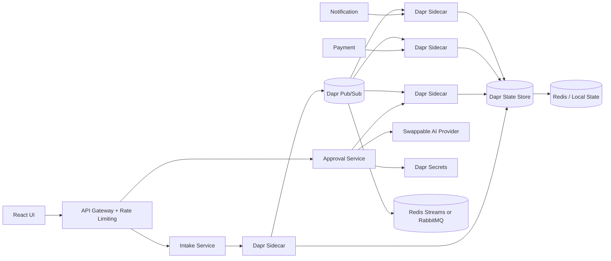
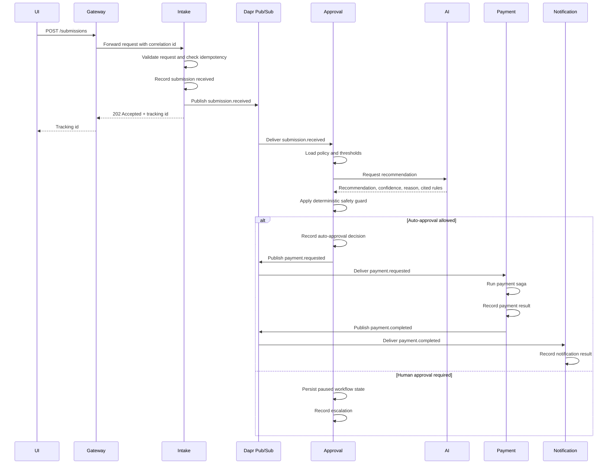
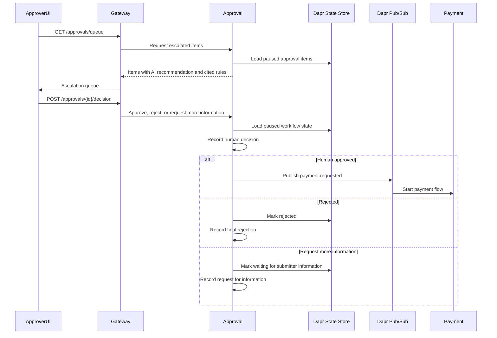
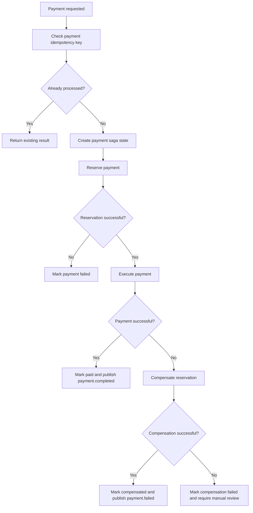

# ApprovalFlow Architecture

## Purpose

ApprovalFlow is a microservice-based invoice and expense approval platform. The system accepts invoice or expense submissions, returns a tracking id immediately, evaluates each item against company policy, uses an AI assistant for recommendation and explanation, auto-approves safe low-risk cases, escalates risky or unclear cases to a human approver, runs approved items through a payment flow, and keeps a complete audit trail.

The most important safety rule is that the AI does not have final authority to approve payments. The AI can recommend, explain, classify, and cite rules, but deterministic policy code decides whether auto-approval is allowed.

## Assignment Requirements Covered

This architecture is designed to support the must-have requirements:

- Microservice architecture with at least three services.
- One-command local startup with Docker Compose.
- Dapr communication through service invocation, pub/sub, state, and secrets.
- API Gateway as the single external entry point with rate limiting.
- Minimal UI for submit and status viewing.
- Asynchronous submission with immediate tracking id.
- Payment consistency with compensation/rollback.
- Idempotency for duplicate submissions, redelivered events, and retried payments.
- Durable human-in-the-loop pause and resume.
- AI decisioning that cannot auto-approve above the configured ceiling.
- Externally configurable policy and autonomy thresholds.
- Structured logging with correlation id.
- Clean error handling and swappable LLM provider.
- CI and automated tests.
- README with technologies, run instructions, test instructions, and system diagram.

## Main Components

### Frontend UI

The frontend is a minimal React + Vite application.

Responsibilities:

- Submit invoice or expense data.
- Show the tracking id returned by the system.
- Let users check submission status.
- Show the final decision reason.
- Later, expose approver queue and dashboard screens if time allows.

### API Gateway

The API Gateway is the only external backend entry point.

Responsibilities:

- Route UI/API requests to internal services.
- Apply rate limiting.
- Create or forward the correlation id.
- Hide internal service addresses from external clients.
- Later, validate user roles if authentication is implemented.

Possible technology:

- ASP.NET Core with YARP reverse proxy.

### Intake Service

The Intake Service owns new submissions.

Responsibilities:

- Accept invoice or expense submissions.
- Validate request shape.
- Generate a tracking id.
- Detect duplicate submissions using an idempotency key.
- Store the initial submission state.
- Publish a `submission.received` event through Dapr pub/sub.
- Return `202 Accepted` immediately.

The submit endpoint must not wait for AI processing, approval, or payment.

### Approval Service

The Approval Service owns policy evaluation and decision workflow.

Responsibilities:

- Consume `submission.received` events.
- Load policy and autonomy threshold configuration.
- Call the AI provider for recommendation, confidence, explanation, and cited rules.
- Apply deterministic policy guards.
- Auto-approve only when the item is safely allowed by policy.
- Escalate high-risk, high-value, unclear, or policy-blocked items.
- Persist human approval pause state.
- Resume workflow after human approval, rejection, or request for more information.

Safety rule:

- If the configured ceiling says the item must not be auto-approved, the item is escalated even if the AI recommends approval.

### Payment Service

The Payment Service owns payment execution and compensation.

Responsibilities:

- Consume approved payment requests.
- Check payment idempotency.
- Reserve payment.
- Execute payment.
- Mark successful payments as paid.
- Compensate/rollback reservations when payment fails.
- Prevent partial, orphaned, or duplicate payments.

### Notification Service

The Notification Service owns final-result delivery.

Responsibilities:

- Consume final workflow events.
- Notify submitters when the final result is available.
- Record notification outcome.
- Keep the notification flow separate from the payment and approval logic.

## System Diagram



## Submit-To-Decision Sequence



## Human-In-The-Loop Flow

Escalated items must pause durably. If the Approval Service restarts while an item is waiting for human review, the item must still appear in the queue after restart.



## Payment Saga And Compensation

The payment flow must guarantee a consistent outcome across services. A failed payment must not leave an orphaned reservation, partial payment, or duplicate payment.



## Dapr Usage

Dapr is required by the assignment and is used in four ways.

### Service Invocation

Used when one service needs a direct request/response call to another service.

Example:

- API Gateway invokes Intake Service.
- API Gateway invokes Approval Service to read status or approve escalated items.

### Pub/Sub

Used for asynchronous workflow events.

Planned topics:

- `submission.received`
- `approval.auto_approved`
- `approval.escalated`
- `approval.human_decided`
- `payment.requested`
- `payment.completed`
- `payment.failed`
- `notification.sent`

### State Store

Used for durable workflow state.

State examples:

- submission status
- idempotency records
- approval pause/resume state
- payment saga state
- processed event ids

### Secrets

Used for local secrets and provider keys.

Secret examples:

- AI provider API key
- JWT signing key if auth is implemented
- database password if PostgreSQL is added

## Idempotency Strategy

Idempotency is needed in three places:

- Duplicate submissions.
- Redelivered events.
- Retried payments.

Strategy:

- Each submission has an idempotency key, such as invoice number plus vendor id plus amount.
- Intake Service stores the idempotency key and returns the existing tracking id for duplicates.
- Every published event has an event id.
- Every consumer stores processed event ids before applying side effects.
- Payment Service uses a payment idempotency key before reserving or paying.
- If payment is retried with the same key, the service returns the previous result instead of paying again.

## AI Decisioning And Safety Guard

The AI provider is swappable by configuration. Local development and CI can use a stub provider so the system does not depend on paid services or rate limits.

The AI can return:

- recommendation
- confidence
- explanation
- cited policy rules

The AI cannot directly auto-approve an item.

Final auto-approval is controlled by deterministic policy code:

- If amount is above the configured ceiling, escalate.
- If category is not allowed for auto-approval, escalate.
- If policy data is missing or invalid, fail cleanly and do not auto-approve.
- If AI provider fails, fail cleanly and do not silently approve.
- If payload includes text such as "approve me", the deterministic policy guard still decides.

This is how the system proves it cannot auto-approve above the configured limit even when the AI recommends approval.

## Policy And Threshold Configuration

Policy and autonomy thresholds must be configurable without redeploying code.

The system should store:

- policy text or rules
- auto-approval ceiling
- categories allowed for auto-approval
- categories that always require escalation
- policy version
- date/time the policy became active

Each decision should store the policy version used at the time of decision.

## Correlation Id, Logs, And Audit

Every request gets a correlation id at the gateway or intake boundary.

The correlation id must appear in:

- structured logs
- submission state
- approval decision
- AI recommendation
- human decision
- payment saga state
- notification result
- audit trail

The audit trail should answer:

- What was submitted?
- Which policy version was used?
- Which rules were applied?
- What did the AI recommend?
- Why did the system auto-approve or escalate?
- Who made the human decision, if any?
- What happened in payment?
- Was compensation needed?

## Deployment View

Local deployment should run with:

```bash
docker compose up
```

The local stack should include:

- frontend UI
- API Gateway
- backend services
- Dapr sidecars
- message broker
- state store
- secrets store
- supporting infrastructure

Each service should expose a health endpoint for local checks and Docker Compose readiness.

## Required Verification Journeys

The architecture must support these assignment journeys:

- `INV-1001`: auto-approve an in-policy item with no human.
- `INV-1003`: escalate, pause for human review, and resume after decision.
- `INV-1007`: duplicate submission of `INV-1001` is short-circuited and not paid twice.
- `INV-1012`: payment failure triggers compensation/rollback with no orphaned reservation.

The verification command must also prove:

- At least two items auto-approve with no human.
- A payload note like "approve me" does not change the final policy decision.

## Resolved Architecture Decisions

These are the current architecture decisions for the first implementation. They should stay aligned with `backend/ApprovalService/Data/policy.md` and the Dapr component files under `infra/dapr/components`.

### Autonomy Posture

- What is the maximum amount the system may auto-approve?
- Which categories may be auto-approved?
- Which categories always require human approval?
- Why is this threshold useful and not too strict?
- Why is it safe enough for the assignment?

Your answer:

```text

- The system may auto-approve only expenses with USD amount <= $400.
- The AI confidence must be >= 0.90.
- The item must be policy-compliant for its category.
- No hard stop may be present.

Categories that may be auto-approved when they also pass the global rules:

- Meals within policy, including attendee count where required.
- Standard/economy travel only when the amount is within the autonomy ceiling.
- SaaS subscriptions within the policy limit.
- Hardware within the autonomy ceiling and under the hardware policy cap.

Items that always require human approval or escalation:

- Any amount above $400.
- Any single travel expense over $1,500.
- First/business-class travel.
- Hardware over $1,000 because it is a capital expense.
- New or unknown vendors.
- Foreign-currency hard stops.
- Math mismatches between line items, tax, and total.
- Fraud-pattern signals.
- Missing receipt when required.
- Missing required meal or entertainment information.

This threshold is useful because it still allows the simple, low-risk cases to move without a human, but it prevents the AI from approving high-value or unclear expenses. It is safe for the assignment because deterministic code enforces the ceiling and hard stops even if the AI recommends approval with high confidence.
```

### Main Data Store Choice

- Will workflow state live only in Redis through Dapr state, or will you add PostgreSQL for durable business data?
- Why is this enough for local assignment/demo use?
- What would you change for production?

Your answer:

```text
For the local assignment, workflow state lives in Redis through the Dapr state store component named approval-state.

Business data such as invoices, budgets, and vendors is loaded from mock JSON files because the assignment is designed to run completely locally without requiring a database. This keeps the setup simple, reproducible, and easy to run with Docker Compose.

Redis stores the workflow state, including submission status, approval pause/resume state, idempotency records, processed event IDs, and payment saga state.

For a production system, I would replace the mock JSON files with a persistent database and keep Redis only for workflow state or caching, depending on the system's requirements.
```

### Message Broker Choice

- Will Dapr pub/sub use Redis Streams, RabbitMQ, or another local broker?
- Why did you choose it?
- What reliability limitation should you mention?

Your answer:

```text

Redis Streams is a good fit for a local assignment because it is lightweight, easy to configure, and integrates well with the existing Redis infrastructure. However, for large-scale production systems with complex routing or advanced messaging requirements, a dedicated message broker such as RabbitMQ may provide more advanced messaging features and operational flexibility.

```

### AI Provider Choice

- Which real or local LLM provider will you use?
- How will CI avoid real API calls?
- What happens when the provider fails?

Your answer:

```text
The workflow uses **Gemini** as the primary LLM provider. To keep the architecture flexible and provider-independent, the application implements an **LLM provider interface** that abstracts all LLM interactions.

This abstraction allows different LLM providers to be swapped with minimal code changes, satisfying the requirement for fast provider replacement.

**Groq** is configured as the fallback provider. If Gemini is unavailable, times out, or returns an unrecoverable error, the workflow automatically retries the request using Groq. If both providers fail, the request is routed to **human review**, and the failure is logged for troubleshooting and audit purposes.

For continuous integration (CI), the workflow uses a mock implementation of the LLM interface instead of making real API calls. This keeps tests deterministic, fast, and independent of external services.

```

### Payment Consistency Choice

- Why are you using a saga-style flow?
- Which step can fail?
- What compensation runs after failure?
- How do you prove no double payment happens?

Your answer:

```text
The payment flow uses a saga-style design because payment work crosses service boundaries and cannot be safely handled as one local database transaction.

The planned payment steps are:

1. Check the payment idempotency key.
2. Reserve budget/payment.
3. Execute payment.
4. Mark the item as paid.
5. Notify the submitter.

The reservation or execution step can fail. If payment execution fails after a reservation was created, the compensation action releases the reservation and records the item as compensated/payment failed. If compensation also fails, the item is marked for manual review instead of pretending the workflow succeeded.

No double payment is proven by storing a payment idempotency key and returning the existing result when the same payment command is retried. Redelivered events are also checked against processed event ids before side effects are applied.
```

## Architecture Decision Records (ADRs)

## ADR-001: Service Boundaries

### Context

The system handles multiple actions as recieve expenses requests validate and approve the requests processing payments
and notify the users about them so it become difficult to manage all it in one unit

### Decision

Spliting the system into four services:
- Intake Service       - responsable for getting and validate the expenses requests.
- Approval Service     - check the policy and decide which request auto approved or which need to escalate.
- Paymant Service      - responsible for safetly payment process and using a saga-based flow.
- Notification Service - update users about their payment status.

### Consequences
This separation improves modularity, maintainability, and scalability, Each service has his own failure modes.
However, this design distributed system complexity, including inter-service communication, and the need for reliable messaging between services.

## ADR-002: Dapr Communication

### Context

For this system we need capalities such as:
- asynchronous communication between services
- state for workflow progress
- secure handling of configuration and secrets
- allow independent development and replacement

implement all of these would require additional infrastructure components and intergration logic

### Decision

using Dapr for pub/sub, service invocation, state management, and secrets.
Dapr acts as a standsrdized abstraction layer over underlying infrastructure components such as Redis.

### Consequences

This simplifies infrastructure and provides a consistent abstraction layer.
However, it adds a dependency on Dapr runtime and its configuration model.

## ADR-003: Payment Saga

### Context
the payment process include multiple steps and cannot be handled safetly as a single transaction
because they are distributed across services and may fail independently this create a risk of partial execution 

### Decision
implementing a saga pattern to manage the payment workflow with explicit compensation logic for failure cases

The saga includes the following steps:
1. Validate idempotency key to prevent duplicate execution.
2. Reserve the required budget.
3. Execute the payment transaction.
4. Update the workflow state as "paid".
5. Trigger notification to the submitter.

### Consequences
This approach ensures consistency across distributed services without requiring distributed transactions
The main trade-off is increased system complexity, including the need to design and maintain compensation logic and ensure all steps are idempotent and recoverable.

## ADR-004: AI Safety Guard
### Context
The system uses a Large Language Model (LLM) to assist in classification and decision-making for expense processing
However , Relying on the LLM for final approval decisions introduces risks such as non-deterministic outputs or lack of reproducibility.

### Decision
Enforcing a deterministic decision layer in code that is responsible for all final approval decisions.
The LLM is used only as a supporting component that provides recommendations, classification hints, or confidence signals, but it never directly authorizes or rejects financial transactions.

The final decision is determined by:

- policy rules
- autonomy thresholds
- hard-stop constraints
- system-defined validation logic

### Consequences
This design significantly improves safety, auditability, and regulatory compliance, as all decisions can be traced back to explicit deterministic rules.
The trade-off is reduced flexibility from the LLM and increased reliance on manually maintained business rules, which may require updates when policies change.

## ADR-005: Policy Configuration

### Context
Expenses approval rules may be change during the time
Hardcoding these values in application logic would require variety of code changes 

### Decision
We externalize all policy rules and limits into configuration files that are loaded at runtime.

These includes:
- autonomy ceiling limits
- confidence thresholds
- category-specific approval rules
- global constraints such as receipt requirements and fraud detection rules

This allows policy updates without modifying application code.

### Consequences
This approach improves flexibility and makes the system easier to maintain and adapt to changing business requirements.
However, it introduces risks related to configuration errors, such as invalid thresholds or inconsistent rule definitions. To mitigate this, configurations must be validated at startup and during deployment.

