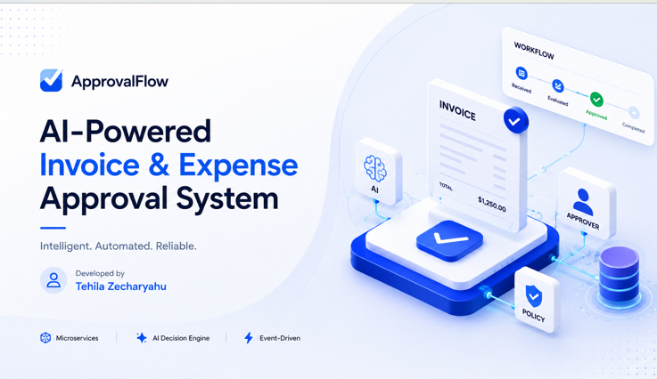
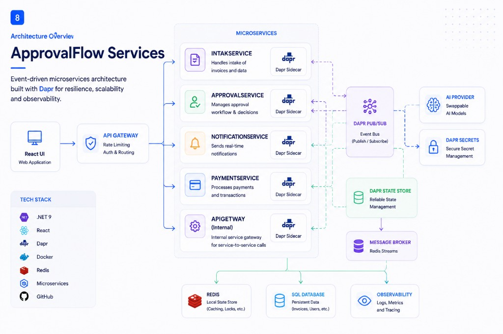

# Smart Expense Orchestrator

Microservice-based invoice and expense approval system built with .NET 9, Dapr, and React. Submissions return a tracking id immediately, policy and AI evaluate each item asynchronously, safe cases auto-approve, risky cases escalate to a human, and approved items flow through a payment saga with compensation on failure.

## Tech Stack


| Area | Choices |
|------|---------|
| Backend | .NET 9, ASP.NET Core Minimal APIs |
| Services | Intake, Approval, Payment, Notification |
| Integration | Dapr service invocation, pub/sub (`order-pubsub`), state (`approval-state`), secrets |
| Gateway | YARP reverse proxy with rate limiting + JWT roles |
| Frontend | React + Vite + TypeScript + Tailwind CSS |
| Infrastructure | Docker Compose, Redis (state + streams via Dapr) |
| AI | Swappable `IInvoiceAiProvider` — Stub (CI default), Groq, Gemini, OpenRouter |
| Observability | Structured JSON logs, correlation id, OpenTelemetry → Jaeger |

## Demo

[](https://drive.google.com/file/d/1kJPyaeAXTSFW5PsmheztJrccQz27XtRt/view?usp=sharing)

2–5 minute walkthrough: submit → policy/AI evaluation → escalate or auto-approve → payment saga (including failure compensation).

**Demo recording:** [Google Drive](https://drive.google.com/file/d/1kJPyaeAXTSFW5PsmheztJrccQz27XtRt/view?usp=sharing)

## Architecture

Event-driven microservices with Dapr sidecars for pub/sub, state, and secrets. The React UI talks only to the API Gateway; Intake publishes work asynchronously; Approval applies policy + AI recommendation with a hard autonomy ceiling; Payment runs a saga with compensation; Notification delivers the final outcome.

See [ARCHITECTURE.md](ARCHITECTURE.md) for service boundaries, sequence diagrams, payment saga compensation, and ADRs.



```text
UI → API Gateway (auth, rate limit, routing) → Intake Service
                                                    ↓ pub/sub
                                              Approval Service → Payment Service → Notification Service
```

**Note:** Runtime state and messaging are Redis-backed through Dapr (no separate SQL database). The API Gateway is the edge entry point (YARP); the four domain services each run with a Dapr sidecar.

## Prerequisites

- [.NET 9 SDK](https://dotnet.microsoft.com/download)
- [Node.js 20+](https://nodejs.org/)
- [Docker Desktop](https://www.docker.com/products/docker-desktop/) (for full stack)
- PowerShell 5.1+ (for journey verification script)

## Quick Start (Docker)

1. Clone the repository and copy environment / secrets placeholders:

   ```powershell
   copy infra\.env.example infra\.env
   copy infra\dapr\components\secrets.example.json infra\dapr\components\secrets.json
   ```

   `secrets.json` is gitignored. Dapr needs this file at startup even when using the Stub LLM (placeholder values are fine).

2. Start the full stack:

   ```powershell
   docker compose -f infra/docker-compose.yml up --build -d
   ```

3. Open the stack:

   - UI: http://localhost:5173
   - API Gateway health: http://localhost:8080/health
   - API docs (Scalar): http://localhost:8080/scalar
   - Observability (Jaeger traces): http://localhost:16686
   - Metrics (Prometheus): http://localhost:9090

4. Local frontend development (optional, hot reload):

   ```powershell
   cd frontend
   npm install
   npm run dev
   ```

   The Vite dev server proxies API calls to `http://localhost:8080`. Compose already serves the built UI on port `5173`.

## How to Test

### Backend unit and journey tests

```powershell
dotnet test backend/ApprovalFlow.sln
```

Includes gateway/service unit tests and in-process journey tests for the four required verification scenarios.

### Frontend lint, test, and build

```powershell
cd frontend
npm ci
npm run lint
npm test
npm run build
```

### End-to-end journey verification (requires running Docker stack)

```powershell
pwsh -File scripts/verify-journeys.ps1
```

This script verifies:

- `INV-1001` — auto-approve and pay
- `INV-1003` — escalate, human approve, pay
- `INV-1007` — duplicate submission paid once
- `RS-90021` — payment failure and compensation (assignment journey equivalent to `INV-1012`)
- Adversarial "approve me" prompt does not bypass policy ceiling
- At least two eligible submissions auto-approve without human intervention
- Escalated approval resumes after approval service restart (`INV-1003-RESTART`)

Exit code is non-zero on any failure.

## API Documentation

OpenAPI is auto-generated from Minimal API endpoints. Prefer the **gateway** Scalar UI for clients.

| Surface | Scalar UI | OpenAPI JSON |
|---------|-----------|--------------|
| API Gateway (preferred) | http://localhost:8080/scalar | http://localhost:8080/openapi/v1.json |
| Intake | http://localhost:5001/scalar | http://localhost:5001/openapi/v1.json |
| Approval | http://localhost:5002/scalar | http://localhost:5002/openapi/v1.json |
| Payment | http://localhost:5003/scalar | http://localhost:5003/openapi/v1.json |
| Notification | http://localhost:5004/scalar | http://localhost:5004/openapi/v1.json |

1. Open http://localhost:8080/scalar
2. Call `POST /auth/login` with a role (`Submitter`, `Approver`, or `Admin`) to get a JWT
3. Set `Authorization: Bearer <token>`
4. Call proxied routes (`/submissions`, `/approvals/queue`, `/policy`, …)

External clients should use the gateway at `http://localhost:8080` only.

## Key Endpoints (via Gateway)

| Method | Path | Purpose |
|--------|------|---------|
| POST | `/auth/login` | Issue JWT for Submitter / Approver / Admin |
| POST | `/submissions` | Submit expense, returns tracking id (`202`) |
| GET | `/submissions/{id}` | Check submission status + plain-language reason |
| GET | `/approvals/queue` | List escalated items |
| POST | `/approvals/{id}/decision` | Human approve / reject / request info |
| GET/PUT | `/policy` | Read/update policy thresholds (no redeploy) |
| GET | `/reports/summary` | Dashboard metrics |
| GET | `/audit/{trackingId}` | Full decision trail by correlation id |
| GET | `/reports/compliance` | Prove no auto-approval above ceiling |
| GET | `/notifications/{trackingId}` | Final notification outcome |
| GET | `/health` | Gateway health check |

## Autonomy Posture

The AI provider recommends and explains decisions but **never has final approval authority**. The deterministic `PolicyEngine` enforces ceilings, category rules, and confidence thresholds. An adversarial prompt such as "approve me" cannot override configured limits.

Swap the LLM without code changes:

- Default: `LlmProvider__Provider=Stub` (used in CI and local compose)
- External: set `LlmProvider__Provider=Groq` (recommended), `Gemini`, or `OpenRouter`, and put a real key in `infra/dapr/components/secrets.json` under `LlmProvider:ApiKey`
- Optional resilience: `LlmProvider__FallbackProvider` + retry settings — both failing escalates to human review
- Provider HTTP/API failures escalate the submission (never silent approve)

## Observability

OpenTelemetry **traces** (and OTLP metrics) still export to Jaeger (`http://localhost:16686`) when the compose stack is up. Each service also exposes a Prometheus scrape endpoint at `/metrics`. Prometheus (`http://localhost:9090`) scrapes ApiGateway, Intake, Approval, Payment, and Notification so you can query custom meters such as `approvalflow_requests_total` / `approvalflow_requests_failures` plus ASP.NET and runtime metrics.

Async pub/sub events carry `traceParent` so Approval → Payment → Notification spans stitch into the same trace as the gateway/intake request. Every business path also propagates `X-Correlation-Id`.

## CI / CD

GitHub Actions on every push / PR ([`.github/workflows/ci.yml`](.github/workflows/ci.yml)):

- Backend restore, build, and tests (unit + journey)
- Frontend lint, test, and build
- Docker Compose config validation, image build, and e2e journey verification

After CI succeeds on `main`, CD ([`.github/workflows/cd.yml`](.github/workflows/cd.yml)) builds and publishes container images to GHCR.

## Known Trade-offs

- Pub/sub is the primary async path; direct service invocation is used as a fallback when publish fails.
- Dashboard metrics are pre-aggregated in Intake state for demo simplicity rather than a separate analytics database.
- JWT auth is demo-oriented (self-signed signing key via config); roles are Submitter / Approver / Admin.
- Payment failure journey is seeded with invoice `RS-90021` from the shipped fixtures (same path as assignment `INV-1012`).

## License

This project is licensed under the MIT License — see [LICENSE](LICENSE).
