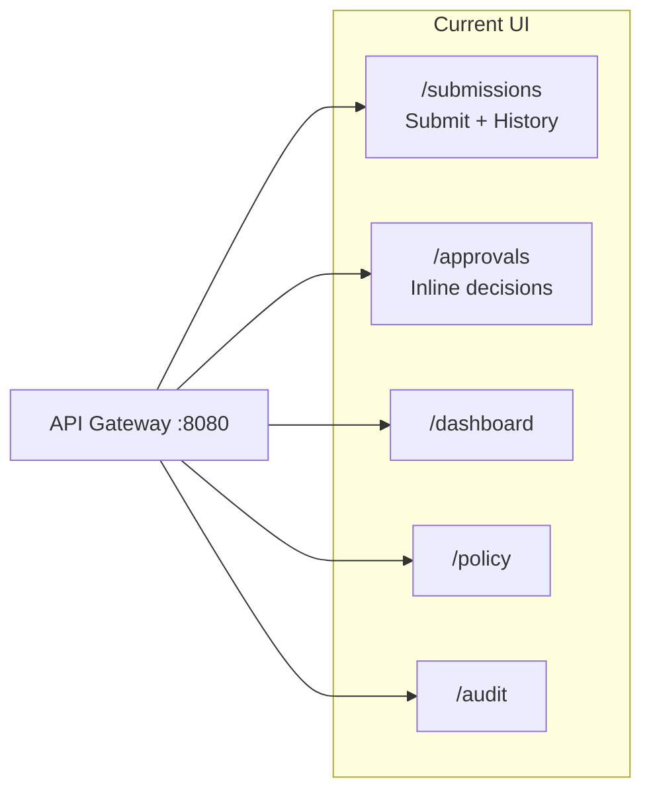

# ApprovalFlow UI Guide

Frontend gap analysis and recommendations mapped to user stories **F1–F10**.

This document complements the frontend section in [PLAN.md](PLAN.md) and reflects the **actual** React codebase under [frontend/src/](frontend/src/).

---

## 1. Purpose and UI Principles

ApprovalFlow’s UI is a **minimal, demo-friendly** React + Vite single-page application. It is not a full design system.

| Principle | Implementation |
|-----------|----------------|
| Plain-language outcomes | Status badges and copy should explain decisions in human terms, not raw backend codes |
| Gateway-only API access | All calls go through the API Gateway via [frontend/src/config/api.ts](frontend/src/config/api.ts) |
| Role-based navigation | [frontend/src/types/userRole.ts](frontend/src/types/userRole.ts) — Submitter, Approver, Admin (demo role switcher; JWT auth is Nice-to-Have N1) |
| Card-based layout | White cards on light gray background, max content width ~960px |
| Async submission UX | Submit returns immediately with a tracking id; processing continues in the background |

**Visual style (from PLAN):**

- Header: product name `ApprovalFlow`, role badge, navigation links
- Status badges: color-coded pills (`Received`, `Processing`, `AutoApproved`, `Escalated`, `Paid`, etc.)
- Forms: labeled inputs, inline validation, one primary submit button
- Tables: compact rows with key fields first; detail view on click where applicable

---

## 2. Current Screen Inventory

| Route | Page | Roles | Backend APIs |
|-------|------|-------|--------------|
| `/submissions` | [MySubmissionsPage.tsx](frontend/src/pages/MySubmissionsPage.tsx) | Submitter, Admin | `POST /submissions`, `GET /submissions`, `GET /submissions/{id}` |
| `/approvals` | [ApprovalsQueuePage.tsx](frontend/src/pages/ApprovalsQueuePage.tsx) | Approver, Admin | `GET /approvals/queue`, `POST /approvals/{id}/decision` |
| `/dashboard` | [DashboardPage.tsx](frontend/src/pages/DashboardPage.tsx) | Admin | `GET /reports/summary` |
| `/policy` | [PolicySettingsPage.tsx](frontend/src/pages/PolicySettingsPage.tsx) | Admin | `GET /policy`, `PUT /policy` |
| `/audit` | [AuditTrailPage.tsx](frontend/src/pages/AuditTrailPage.tsx) | Admin | `GET /audit/{trackingId}` |

### Design deviation from PLAN

- **Submit + Track merged:** PLAN specifies separate `/submit` and `/track` routes; the app combines both on `/submissions`.
- **No escalation detail page:** PLAN specifies `/approvals/:trackingId` with a two-column review layout; decisions happen inline in the queue table.
- **No dedicated login page:** Role switching via [RoleSwitcher.tsx](frontend/src/components/layout/RoleSwitcher.tsx) replaces `/login` for local demo.

### Key components

| Area | Files |
|------|-------|
| Submit form | [SubmitExpenseForm.tsx](frontend/src/components/submissions/SubmitExpenseForm.tsx) |
| History table | [SubmissionHistoryTable.tsx](frontend/src/components/submissions/SubmissionHistoryTable.tsx) |
| Status badges | [StatusBadge.tsx](frontend/src/components/submissions/StatusBadge.tsx) |
| Escalation queue | [EscalationQueueTable.tsx](frontend/src/components/approvals/EscalationQueueTable.tsx) |
| Layout / nav | [AppLayout.tsx](frontend/src/components/layout/AppLayout.tsx), [Sidebar.tsx](frontend/src/components/layout/Sidebar.tsx) |
| API services | [submissionService.ts](frontend/src/services/submissionService.ts), [approvalService.ts](frontend/src/services/approvalService.ts), [reportService.ts](frontend/src/services/reportService.ts), [auditService.ts](frontend/src/services/auditService.ts) |

---

## 3. User Story Coverage Matrix (F1–F10)

### F1 — Submit invoice/expense and get immediate acknowledgement with tracking id

**Role:** Submitter  
**Status:** Partial (backend complete; UI acceptable but not spec-perfect)

**What works today:**

- [SubmitExpenseForm.tsx](frontend/src/components/submissions/SubmitExpenseForm.tsx) validates vendor, invoice number, amount, and category before submit
- `POST /submissions` returns tracking id; toast shows acceptance message
- Duplicate resubmit noted in toast: “existing submission returned” ([MySubmissionsPage.tsx](frontend/src/pages/MySubmissionsPage.tsx))

**Gaps vs PLAN / F1:**

| Gap | Notes |
|-----|-------|
| No dedicated post-submit success panel | PLAN expects large tracking id, “View Status” button, “Processing continues in background” note |
| No currency field | Hardcoded USD in form label |
| No description/notes or attachment reference | Backend `SubmissionRequest` also lacks these fields |
| Combined page | No dedicated `/submit` route |

**Suggested files to change:** `MySubmissionsPage.tsx`, `SubmitExpenseForm.tsx`, optionally split into `SubmitExpensePage.tsx`

---

### F2 — Check submission status and see plain-language reason for outcome

**Role:** Submitter  
**Status:** Partial — **largest submitter gap**

**What works today:**

- Auto-refreshing submission history table (5s interval)
- Status badges via [StatusBadge.tsx](frontend/src/components/submissions/StatusBadge.tsx)
- Manual refresh button on history table

**Gaps:**

| Gap | Notes |
|-----|-------|
| **`reason` never displayed** | API returns `reason` ([SubmissionStatusResponse](frontend/src/types/api.ts)); not mapped in [submissionService.ts](frontend/src/services/submissionService.ts) or shown in table |
| No detail / track view | No row click, no workflow timeline (Received → Processing → Decision → Payment) |
| No tracking-id search | PLAN expects search box on `/track`; not implemented |
| Status over-simplified | [mapSubmissionStatus.ts](frontend/src/utils/mapSubmissionStatus.ts) collapses backend statuses into 4 UI buckets — loses `Paid`, `AutoApproved`, `PaymentFailed`, etc. |

**Suggested files to change:** `SubmissionHistoryTable.tsx`, `submissionService.ts`, `types/submission.ts`, new `SubmissionDetailPanel.tsx` or `TrackSubmissionPage.tsx`

---

### F3 — Accidental duplicate submission must not be paid twice

**Role:** Submitter  
**Status:** Partial (backend idempotency done; UI feedback weak)

**What works today:**

- Backend returns `isDuplicate: true` with same tracking id
- Toast mentions duplicate on resubmit

**Gaps:**

| Gap | Notes |
|-----|-------|
| No persistent duplicate indicator in history | Resubmit looks like a normal row after toast dismisses |
| No explanation that payment will not run again | F3 trust requires visible reassurance |
| No side-by-side first vs duplicate comparison | Hard to demo idempotency in UI |

**Suggested files to change:** `MySubmissionsPage.tsx`, `SubmissionHistoryTable.tsx`, `SubmissionRecord` type

---

### F4 — Escalation queue with AI recommendation, confidence, and cited policy rules

**Role:** Approver  
**Status:** Partial

**What works today:**

- Queue shows **escalated items only** (backend filter)
- AI recommendation badge and confidence % ([EscalationQueueTable.tsx](frontend/src/components/approvals/EscalationQueueTable.tsx))
- Auto-refresh every 5s

**Gaps:**

| Gap | Notes |
|-----|-------|
| **`citedRules` not rendered** | API includes them ([EscalationQueueItem](frontend/src/types/api.ts)); backend sends via [ApprovalRoutes.cs](backend/ApprovalService/Routes/ApprovalRoutes.cs) |
| **Escalation `reason` not rendered** | Same — available in API, missing in table |
| No filter bar | PLAN: filter by status, category, amount range |
| No “Review” button | PLAN: navigate to detail page instead of inline-only actions |

**Suggested files to change:** `EscalationQueueTable.tsx`, optionally new `EscalationDetailPage.tsx`

---

### F5 — Approve, reject, or request more info; workflow resumes from pause

**Role:** Approver  
**Status:** Partial

**What works today:**

- Inline **Approve** and **Reject** buttons in queue table
- Backend supports `RequestInfo` decision type ([ApprovalDecision](frontend/src/types/api.ts))
- Success toast after decision; item leaves queue on refresh

**Gaps:**

| Gap | Notes |
|-----|-------|
| **Missing “Request More Info” button** | Third action from F5 not exposed |
| No approver comment input | Hardcoded comment in [ApprovalsQueuePage.tsx](frontend/src/pages/ApprovalsQueuePage.tsx) |
| No escalation detail page | PLAN two-column layout: submission details + AI panel |
| No redirect after action | Toast only; PLAN expects redirect back to queue |

**Suggested files to change:** `EscalationQueueTable.tsx`, `ApprovalsQueuePage.tsx`, new `EscalationDetailPage.tsx`

---

### F6 — Approver should not rubber-stamp items the system could safely auto-handle

**Role:** Approver  
**Status:** Mostly met (by backend design)

**What works today:**

- Queue contains **only escalated** items; auto-approved submissions never appear
- Policy engine enforces ceiling before human review

**UI enhancement opportunity:**

- Show **escalation reason** and **cited rules** in queue so approvers understand why the item needs human review (supports F6 intent and reduces blind rubber-stamping)

**Suggested files to change:** `EscalationQueueTable.tsx` (same as F4 gaps)

---

### F7 — Configure expense policy and autonomy thresholds without redeploying

**Role:** Controller / Admin  
**Status:** Mostly done (matches current backend)

**What works today:**

- [PolicySettingsPage.tsx](frontend/src/pages/PolicySettingsPage.tsx): auto-approval ceiling, AI confidence threshold
- Read-only policy version display
- Save warning: “Changes apply to new submissions immediately”

**Gaps vs PLAN:**

| Gap | Notes |
|-----|-------|
| No allowed categories editor | Backend only exposes ceiling + confidence |
| No blocked vendors/keywords | Not in backend API yet |
| No escalation threshold beyond ceiling/confidence | Category rules (hardware, saas) are code-side today |

**Suggested files to change:** `PolicySettingsPage.tsx` (when backend adds fields)

---

### F8 — Dashboard of throughput, auto vs escalation rates, money auto vs human approved

**Role:** Controller / Finance  
**Status:** Mostly done

**What works today:**

- [DashboardPage.tsx](frontend/src/pages/DashboardPage.tsx): total submissions, auto-approval rate, escalation rate, paid count, payment failures
- Auto-approved amount vs human-approved amount (separate cards)
- Recent activity table with invoice, vendor, amount, status, decision type

**Gaps vs PLAN:**

| Gap | Notes |
|-----|-------|
| No chart/bar summary | PLAN suggests visual auto vs human vs rejections vs payment failures |
| “Submissions today” not separated | Shows all-time total only |
| Recent activity missing timestamp | PLAN includes timestamp column |

**Suggested files to change:** `DashboardPage.tsx`, possibly backend `ReportingSummaryResponse` if timestamps needed

---

### F9 — Complete decision trail linked by one correlation id

**Role:** Auditor  
**Status:** Mostly done

**What works today:**

- [AuditTrailPage.tsx](frontend/src/pages/AuditTrailPage.tsx): search by tracking id
- Shows invoice data, policy version, rules applied, AI recommendation/reasoning, human decision, payment result
- Vertical timeline and **copy correlation id** button

**Gaps:**

| Gap | Notes |
|-----|-------|
| Search by correlation id | UI copy mentions correlation id; search input is tracking-id only (backend endpoint is `/audit/{trackingId}`) |
| No cross-links | History table and dashboard rows do not link to audit page |
| No dedicated Auditor role | Admin sees audit today; PLAN implies auditor persona |

**Suggested files to change:** `AuditTrailPage.tsx`, `SubmissionHistoryTable.tsx`, `DashboardPage.tsx`, `userRole.ts`

---

### F10 — Prove the system never auto-approved above the configured limit

**Role:** Auditor  
**Status:** Missing as explicit UI proof

**What works indirectly:**

- Audit trail shows rules applied (`AUTONOMY-CEILING`) and policy version for manual inspection

**Gaps:**

| Gap | Notes |
|-----|-------|
| No auditor-focused proof panel | Should highlight when amount exceeded ceiling at decision time |
| No “amount vs ceiling” comparison | Side-by-side display for evaluator demo |
| No filtered view of auto-approved items | Spot-check list to verify none exceed limit |

**Suggested files to change:** `AuditTrailPage.tsx`, new `PolicyCompliancePanel.tsx`, optionally `DashboardPage.tsx`

---

## 4. Minimum Work Still Required

Priority order before calling the frontend **evaluation-ready**:

| Priority | Item | Stories | Effort |
|----------|------|---------|--------|
| 1 | **Submission detail / track view** — show `reason`, full backend status, workflow stepper; row click or search by tracking id | F2 | Medium |
| 2 | **Display cited rules + escalation reason in queue** — data already in API | F4, F6 | Low |
| 3 | **Request More Info + optional comment** — wire existing `RequestInfo` decision | F5 | Low |
| 4 | **Stronger duplicate feedback** — badge/icon when `isDuplicate: true` | F3 | Low |
| 5 | **Post-submit success panel** — prominent tracking id + link to status detail | F1 | Low |
| 6 | **F10 audit helper** — highlight `AUTONOMY-CEILING` when amount exceeded limit | F10 | Low |

---

## 5. Suggested Enhancements (Beyond Minimum)

Optional improvements that **do not contradict** F1–F10:

| Enhancement | Rationale | Effort |
|-------------|-----------|--------|
| Dedicated `/approvals/:trackingId` detail page | Matches PLAN; better demo for F4/F5 | Medium |
| Split `/submit` and `/track` routes | Clearer role journeys per PLAN | Low |
| Add **Auditor** role (read-only: audit + dashboard) | Maps to F9/F10 personas | Low |
| Dashboard bar chart (auto vs human vs rejected vs failed) | F8 polish | Low |
| Link tracking id → audit from history/dashboard | Faster evaluator demo | Low |
| Expand status badges to full backend vocabulary | F2 plain-language without over-simplification | Low |
| Empty-state demo hints (“Try INV-1003 to see escalation”) | Demo-friendly onboarding | Low |
| Submission notes field (UI + backend) | PLAN form spec; supports “approve me” adversarial demos | Medium |
| Mobile-friendly escalation detail stack layout | PLAN responsive spec | Low (with detail page) |
| Frontend tests (form validation, status rendering) | PLAN Frontend Tests section | Medium |

---

## 6. Role and Navigation Recommendations

### Current roles ([userRole.ts](frontend/src/types/userRole.ts))

| Role | Nav access |
|------|------------|
| **Submitter** | My Submissions |
| **Approver** | Approvals Queue |
| **Admin** | All screens |

### Recommended changes

1. **Add Auditor role** — read-only access to `/audit` and optionally `/dashboard`
2. **Rename nav labels to match PLAN** — “Submit”, “Track”, “Approvals”, “Dashboard”, “Policy”, “Audit”
3. **Keep role switcher** as demo substitute until N1 JWT auth is implemented
4. **Separate Submit and Track** in navigation once track detail page exists

### Target navigation (after minimum gaps closed)

| Nav item | Route | Submitter | Approver | Controller | Auditor |
|----------|-------|-----------|----------|------------|---------|
| Submit | `/submit` | Yes | — | — | — |
| Track | `/track` | Yes | — | — | — |
| Approvals | `/approvals` | — | Yes | Yes | — |
| Dashboard | `/dashboard` | — | — | Yes | Read-only |
| Policy | `/policy` | — | — | Yes | — |
| Audit | `/audit` | — | — | Yes | Yes |

---

## 7. Conclusions

### Overall assessment

The frontend covers approximately **70–80%** of the minimum user stories. Core flows work end-to-end against the live backend:

- Submit → async processing → status updates
- Escalation queue → human approve/reject
- Policy settings, dashboard metrics, audit trail

**Weakest areas:**

- **F2** — submitters cannot see plain-language **reason** or a proper status detail view
- **F5** — missing **Request More Info** and approver comments
- **F10** — no explicit auditor proof that auto-approval never exceeded the configured ceiling

**Strongest areas:**

- **F7** — policy settings without redeploy
- **F8** — dashboard with separate auto vs human money totals
- **F9** — audit trail with timeline and correlation id

### Recommended UI sprint phases

**Phase A — Minimum (evaluation-ready):**

1. Submission detail / track view with reason and workflow stepper
2. Cited rules + escalation reason in queue
3. Request More Info + comment input
4. Duplicate submission UX
5. Post-submit success panel
6. F10 ceiling compliance highlight in audit

**Phase B — Demo polish:**

1. Escalation detail page (`/approvals/:trackingId`)
2. Dashboard chart and timestamps
3. Cross-links (history → audit)
4. Auditor role

**Phase C — Optional:**

1. Notes/description field (UI + backend)
2. Separate `/submit` and `/track` routes
3. Frontend automated tests
4. Full policy admin when backend supports categories/blocked vendors

### Do not block demo on

- Currency selector (USD is fine for demo)
- Attachment / OCR
- Full policy admin (categories, blocked vendors) until backend exposes those APIs
- JWT login (role switcher is sufficient for local demo)

---

## Reference

- Frontend plan: [PLAN.md](PLAN.md) (Frontend Plan section)
- Architecture: [ARCHITECTURE.md](ARCHITECTURE.md)
- API types: [frontend/src/types/api.ts](frontend/src/types/api.ts)
- Run instructions: [README.md](README.md)
